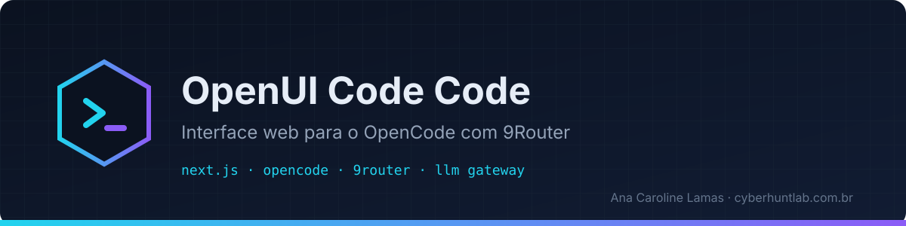

<p align="center"></p>

# OpenUI Code Code — interface web para o OpenCode com 9Router

Interface web em **Next.js** para o agente de código aberto **OpenCode**. Reúne chat com modelos de IA, um agente que **gera e atualiza projetos entregues em ZIP**, catálogo dinâmico de provedores e modelos, publicação no GitHub (ZipToGit) e biblioteca de skills (`SKILL.md`). Esta versão integra o **9Router**, um gateway compatível com a API da OpenAI, com fallback e rotação automática entre provedores.

## Recursos

- **Chat com IA** usando a sessão e o modelo selecionados no servidor OpenCode, com Groq como alternativa quando não há servidor.
- **Agente de projetos em ZIP** (`POST /api/workspace`):
  - cria um projeto do zero a partir de um manifesto de arquivos ou atualiza um ZIP enviado;
  - valida os caminhos, preserva os arquivos não alterados e inclui um README;
  - exclui `.env`, credenciais, `.git`, `node_modules` e artefatos de build;
  - enfileira novas instruções em vez de abortar a tarefa em andamento.
- **Central de modelos**: consulta `GET /provider` do OpenCode, com busca por provedor, modelo ou ID, destaque para modelos gratuitos e conexão por API key (`PUT /auth/:id`).
- **9Router**: botões *Carregar modelos*, *Sincronizar 9Router* e *Start 9Router*. O backend verifica `/health`, sincroniza `/v1/models` e seleciona o combo padrão.
- **Chaves do próprio usuário (BYOK)** para OpenAI, Anthropic, Gemini, GitHub e servidor OpenCode, guardadas no `localStorage` do navegador.
- **GitHub com token pessoal (PAT)** e envio de projetos compactados (ZipToGit).
- **Engenharia reversa de ZIP**: gera uma análise técnica e repassa o arquivo ao agente para uma recriação autorizada.
- **Layout responsivo** com tema escuro e menu lateral recolhível (drawer).

## Instalação

Requisitos: **Node.js 20+**, npm e, para a execução completa, um servidor OpenCode e/ou o 9Router acessíveis pelo backend.

```bash
git clone https://github.com/ticarollamas-arch/openui-code-code-cyberhuntlab-atualizado.git
cd openui-code-code-cyberhuntlab-atualizado
npm install
cp .env.example .env.local
```

### Variáveis de ambiente

| Variável | Uso |
|---|---|
| `OPENCODE_SERVER_URL` / `OPENCODE_SERVER_PASSWORD` | Servidor OpenCode usado pelo backend |
| `OPENCODE_SKILLS_DIR` | Pasta de skills (`SKILL.md`) |
| `NINEROUTER_BASE_URL` / `NINEROUTER_API_KEY` / `NINEROUTER_DEFAULT_COMBO` | Gateway 9Router (padrões: `http://127.0.0.1:20128` e `openui-coding`) |
| `GROQ_API_KEY` | Alternativa quando não há servidor OpenCode |
| `OPENAI_API_KEY`, `GITHUB_TOKEN`, `APP_ACCESS_TOKEN` | Integrações e proteção de rotas |
| `S3_*` | Armazenamento de artefatos (opcional) |

## Como usar

```bash
npm run dev      # http://localhost:3000
npm run build && npm start
npm run lint     # tsc --noEmit
```

1. Abra **Configurações → Central de modelos** e clique em **Carregar modelos** ou **Sincronizar 9Router**.
2. Clique em **Start 9Router** para usar o combo padrão com fallback, ou escolha um modelo do OpenCode.
3. No chat, peça a criação ou alteração de um projeto, ou anexe um ZIP. O resultado chega como resumo com botão de download.

### Configurando o 9Router

1. Rode o 9Router na mesma rede privada do Next.js, na porta padrão `20128`.
2. No painel do 9Router, conecte os provedores e crie um combo (por exemplo, `openui-coding`) com estratégia *Fallback* ou *Round Robin*.
3. Gere uma chave de acesso do 9Router e configure as variáveis `NINEROUTER_*` **somente no servidor**.
4. Se a interface estiver no Vercel e o 9Router num VPS, publique só `/v1/*` e `/health` por HTTPS, usando o modelo em `deploy/nginx-9router-api.conf.example`, e nunca exponha o painel administrativo.

## Limitações

- No Vercel, os ZIPs de entrada e de saída são limitados a 3 MB e a função a 60 s. Projetos maiores exigem um executor persistente (VPS) e armazenamento S3.
- O backend não executa `npm install`, build ou testes no projeto gerado e informa isso no resultado.
- O servidor OpenCode e o 9Router são compartilhados. Para usuários públicos, implemente isolamento de credenciais por usuário.
- Fallback não significa uso ilimitado: cotas, limites e cobrança continuam definidos por cada provedor.

Mais detalhes em [DEPLOY-SECURITY.md](DEPLOY-SECURITY.md), [VERCEL-BUILD-FIX.md](VERCEL-BUILD-FIX.md) e [UPSTREAMS.md](UPSTREAMS.md).

## Tecnologias

Next.js 15 · React · TypeScript · `@opencode-ai/sdk` · 9Router · Groq · JSZip · lucide-react · Vercel · Nginx

## Créditos

- [OpenCode](https://github.com/anomalyco/opencode): motor de execução e arquitetura de agente, usado pelo SDK oficial `@opencode-ai/sdk`. Todos os créditos do motor pertencem aos seus mantenedores; esta aplicação é apenas a camada de interface web.
- [9Router](https://github.com/decolua/9router): gateway compatível com a API da OpenAI.
- [opencode-dynamic-context-pruning](https://github.com/Tarquinen/opencode-dynamic-context-pruning): plugin referenciado em `opencode.json` (AGPL-3.0).
- [RTK — Rust Token Killer](https://github.com/rtk-ai/rtk): referência de economia de tokens citada na página de apresentação.

## Licença

Código deste repositório sob a licença MIT. Veja [LICENSE](LICENSE). Projetos e dependências de terceiros mantêm suas próprias licenças.
